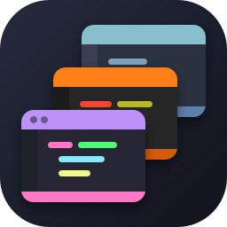
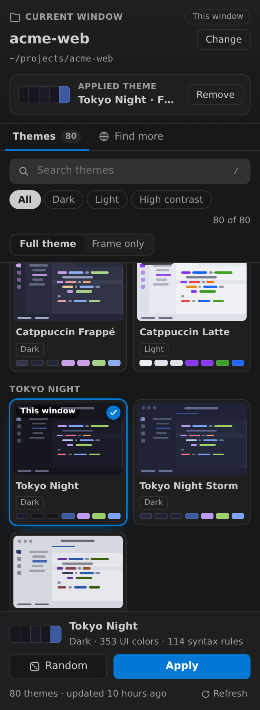
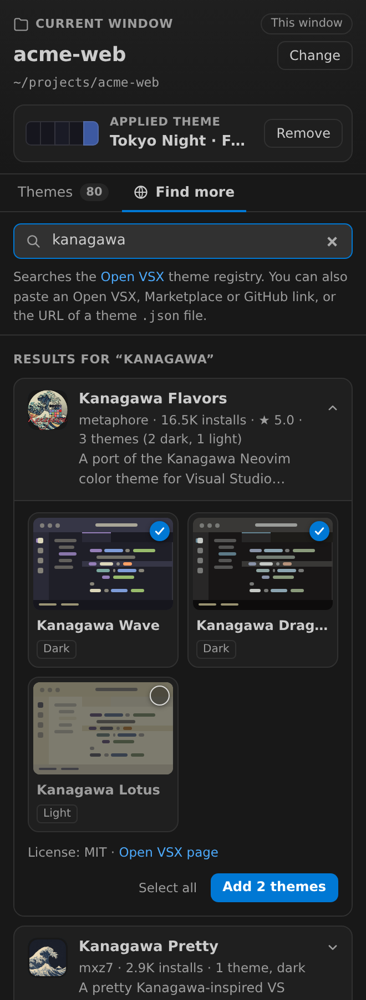
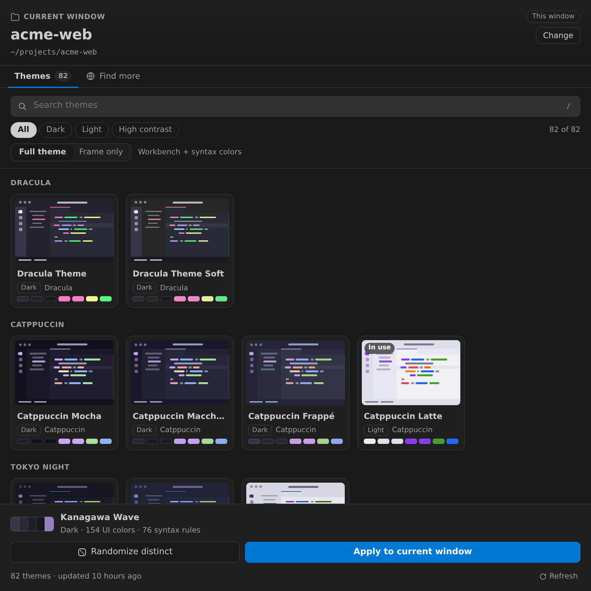

<p align="center"></p>

<h1 align="center">Window Theme Manager</h1>

<p align="center">
  Give every project window its own polished open-source color theme, so you can tell your Antigravity IDE windows apart at a glance.
</p>

<p align="center">
  <a href="https://github.com/Rafat-Aman/AntigravityThemeManagement/actions/workflows/ci.yml"></a>
  <a href="LICENSE"></a>
</p>

<p align="center">
  
  &nbsp;
  
</p>

- **Catalog:** 80 built-in themes from 34 sources: Dracula, Catppuccin, Tokyo Night, Nord, Gruvbox, One Dark Pro, One Light, Rosé Pine, SynthWave '84, Ayu, GitHub, Everforest, Night Owl, Horizon, Shades of Purple, Cobalt2, Noctis, Vitesse, Moonlight, Bluloco, and VS Code's built-in themes (Monokai, Solarized, Abyss, Dark/Light Modern, High Contrast and more).
- **Find more:** search the Open VSX theme registry from the panel, or paste a link (Open VSX, VS Code Marketplace, GitHub, or a raw `.json` theme file). Preview the themes, choose which to keep, and add them to your catalog.
- **Per-window:** a theme is written to `<project>/.vscode/settings.json` under `workbench.colorCustomizations` (plus syntax colors in *Full theme* mode). Every other setting and comment is preserved, and **Remove** restores the file exactly. In a multi-root window, the colors go into the `settings` of its `.code-workspace` file.
- **Randomize distinct:** picks a theme that looks as different as possible from the ones your other windows already use.
- **Offline cache:** themes are downloaded, parsed and cached as JSON, so the picker works offline after the first fetch.

It ships in two forms that share the same panel and backend:

| Form | Where it shows up | Install |
| --- | --- | --- |
| **Editor extension** (`.vsix`) | Antigravity IDE (and other VS Code-based editors): an Activity Bar icon in every window | `bash scripts/install-extension.sh` |
| **Sidecar plugin** | Antigravity hosts that run sidecars: the Agent Manager's Extensions menu. Elsewhere: standalone in a browser tab | `bash scripts/install.sh` |

## Install in Antigravity IDE (editor extension)

**From a release:** download `window-theme-manager-<version>.vsix` from [Releases](https://github.com/Rafat-Aman/AntigravityThemeManagement/releases). In the IDE, open the Extensions view → **…** menu → **Install from VSIX…** and pick the file. From a terminal:

```bash
antigravity-ide --install-extension window-theme-manager-1.1.0.vsix
# Linux, if antigravity-ide is not on PATH:
"/opt/Antigravity IDE/bin/antigravity-ide" --install-extension window-theme-manager-1.1.0.vsix
```

**From source:** requires Node.js 20.10 or newer.

```bash
git clone https://github.com/Rafat-Aman/AntigravityThemeManagement.git
cd AntigravityThemeManagement
bash scripts/install-extension.sh
```

The script installs the build tools, packages `dist/window-theme-manager-<version>.vsix`, and installs it with the IDE's command-line tool (set `IDE_CLI=/path/to/cli` for other VS Code-based editors). Extensions are installed per user, so it is available in **every** window:

- Click the **Window Themes** icon in the Activity Bar. In a window that was already open, run **Developer: Reload Window** if the icon is missing.
- You can drag the view to the secondary side bar or the panel, or use **Window Themes: Open in Editor Tab** for a larger grid.
- Command Palette → **Window Themes: Apply a Random Distinct Theme to This Window**, **Remove Theme From This Window**, **Find More Themes Online**, **Refresh Theme Catalog**.

<p align="center"></p>

The extension knows exactly which window it runs in (each window has its own extension host), so there is no workspace guessing. Its data (cache, your added themes, what is applied where) lives in the IDE's global storage and is shared by all windows. On first start it imports the data of an earlier sidecar or standalone install.

## Install as a sidecar plugin

```bash
bash scripts/install.sh            # → ~/.gemini/config/plugins/window-theme-manager
```

The script copies the plugin, runs `npm install --omit=dev` (one dependency: `jsonc-parser`) and pre-downloads the catalog. It requires Node.js 20.10 or newer.

Sidecars only run in an Antigravity language server started with `--enable_sidecars`, which the binary describes as *"Sidecars should be enabled for at most one server instance per machine"*. On such a host, **Window Themes** appears in the Agent Manager's Extensions menu. Antigravity IDE 1.107 does not pass that flag, which is why the editor extension exists. Standalone mode also works anywhere:

```bash
cd ~/.gemini/config/plugins/window-theme-manager
npm start                 # prints: Open the panel at: http://localhost:4870/?token=…
```

In standalone mode the API needs a random token (stored in `sidecars/theme-picker/.data/standalone-token`), so other web pages cannot call it.

## Using the panel

| Control | What it does |
| --- | --- |
| Header | The workspace for this window. **Change** picks another open window, a known project, or any folder path. |
| **Themes** tab | Your catalog. Search, filter by **All / Dark / Light / High contrast**, and press `/` to focus search. |
| **Full theme / Frame only** | *Full* writes every workbench color the theme defines, plus syntax colors. *Frame* writes only the title bar, activity bar and status bar (the safest way to tell windows apart). |
| **Apply to current window** | Writes the colors to the workspace's settings. Double-clicking a card or pressing `Ctrl/⌘+Enter` also applies. |
| **Randomize distinct** | Selects a theme from the current filter that looks as different as possible (CIE Lab ΔE) from the themes already applied to your other windows. Press Apply to use it. |
| **Remove** | Removes the theme and restores the colors the project had before. |
| **Find more** tab | Search Open VSX or paste a link, preview, then **Add**. See below. |
| **Refresh** | Downloads the catalog again, including the themes you added. Sources that fail keep their cached copies. |

## Adding more themes

**From the panel (no code):** open the **Find more** tab.

1. Type a name (for example `kanagawa`, `material`, `palenight`) to search the Open VSX theme registry. The empty search lists the most-installed color themes. Icon and product-icon themes are filtered out.
2. Or paste a link:
   - `https://open-vsx.org/extension/<publisher>/<name>`, or just `<publisher>.<name>`
   - `https://marketplace.visualstudio.com/items?itemName=<publisher>.<name>` (looked up on Open VSX, which mirrors most themes)
   - a GitHub repository, folder or `package.json` link (`https://github.com/<owner>/<repo>`). If the repository builds its theme files at release time, the published Open VSX version is used instead.
   - a single theme file: a GitHub `blob` link, a raw URL, a gist, or any `https://…/theme.json`
3. Click a result to preview its themes, untick the ones you don't want, and press **Add**. **Show** jumps to them in the Themes tab.

Added themes are marked *Added by you*, survive **Refresh** (they are re-downloaded with the same selection), and can be removed from **Find more → Added by you**. They are stored in `library.json` in the data directory. Windows already using a removed theme keep their colors.

**Built in, for everyone using your copy:** add an entry to `sidecars/theme-picker/lib/catalog-sources.mjs` (`OPENVSX_EXTENSIONS` for Open VSX extensions, `GITHUB_THEMES` for single files), then press **Refresh** or run `npm run fetch-themes`. For the extension, run `bash scripts/install-extension.sh` again.

## How settings.json is edited

- The file is edited with `jsonc-parser`, the library VS Code itself uses. Comments, formatting, key order and all unrelated settings are kept.
- Only keys inside `workbench.colorCustomizations`, `editor.tokenColorCustomizations.textMateRules` (rules tagged `[window-theme-manager]`) and `editor.semanticTokenColorCustomizations` are touched.
- If the theme sets a color you had already customized, your value is saved and restored when you switch themes or press **Remove**. A value you edit by hand after applying is left alone.
- A settings file with syntax errors is never written to; the panel reports the error instead.
- Multi-root windows: VS Code ignores window colors in a folder's settings, so they are written to the `settings` object of the `.code-workspace` file. An unsaved multi-root workspace has to be saved first.
- What was applied where is recorded in the data directory (`applied.json`), not in your project.

> `.vscode/settings.json` is often committed to git. *Full theme* adds a few hundred color keys, so use *Frame only* if you share the file with others, or add it to `.gitignore`.

## Architecture

```
window-theme-manager/
├── package.json                      # npm package + editor-extension manifest (contributes, commands)
├── plugin.json                       # Antigravity plugin marker
├── extension/
│   ├── src/extension.mjs             # extension host: webview view/panel, commands, postMessage → API
│   ├── media/bridge.js               # webview: window.sidecar over postMessage (replaces /preload.js)
│   ├── media/activity.svg, icon.png
│   └── dist/extension.cjs            # bundled by scripts/build-extension.mjs (esbuild)
├── sidecars/theme-picker/
│   ├── sidecar.json                  # node server.mjs, has_web_ui, AUX_PANE view at "/"
│   ├── server.mjs                    # HTTP transport for the API (sidecar / standalone)
│   ├── lib/
│   │   ├── api.mjs                   # all API routes, shared by server.mjs and the extension
│   │   ├── catalog-sources.mjs       # curated theme list
│   │   ├── theme-fetcher.mjs         # download, JSONC parse, include/tokenColors, cache, user sources
│   │   ├── discovery.mjs             # Open VSX search, link parsing, source validation
│   │   ├── library-store.mjs         # themes you added (library.json)
│   │   ├── color-mapper.mjs          # core-color extraction, fallbacks, previews, distinctness
│   │   ├── color-utils.mjs           # hex, contrast, Lab, ΔE helpers
│   │   ├── settings-writer.mjs       # comment-preserving, reversible settings merge
│   │   ├── workspace-resolver.mjs    # folders, .code-workspace files, IDE window state
│   │   ├── applied-store.mjs         # what was applied where (for exact undo)
│   │   ├── agentapi.mjs              # /_sidecar/* bridge (same contract as the SDK)
│   │   └── sdk-preload.mjs           # locates Antigravity's official /preload.js
│   └── public/                       # the panel UI (used by both forms)
│       ├── index.html                # <script src="/preload.js"> + workspace.js + app.js
│       ├── workspace.js              # window.sidecar.getWorkspaceUris() polyfill (sidecar only)
│       ├── app.js, styles.css
│       └── preload-fallback.js       # only used outside Antigravity (standalone)
├── scripts/                          # install.sh, install-extension.sh, build-extension.mjs, fetch-themes.mjs
├── docs/images/                      # README screenshots
├── .github/workflows/ci.yml          # tests, .vsix build, release upload
└── test/                             # node --test
```

The extension rewrites `index.html` for the webview: it adds a strict Content-Security-Policy and loads `bridge.js` in place of `/preload.js`. `bridge.js` provides the same `window.sidecar` interface (`fetch`, `agent.*`, `ui.*`) plus a native `getWorkspaceUris()`, so `app.js` is identical in both forms.

### Antigravity sidecar contract

These details were checked against Antigravity IDE 1.107 (language server 2.5.5):

- Sidecars live in `<customization root>/sidecars/<id>/sidecar.json` or inside a plugin as `plugins/<name>/sidecars/<id>/sidecar.json`. The keys are snake_case (`has_web_ui`, `ui_config.views[].entrypoint`, `restart_policy`).
- The process gets `ANTIGRAVITY_SIDECAR_WEB_PORT`, `ANTIGRAVITY_SIDECAR_UI_TOKEN`, `ANTIGRAVITY_EXECUTABLE_DATA_DIR` and the `agentapi` variables. The panel iframe is loaded with `?token=…&conversationId=…`.
- The platform's `/preload.js` defines `window.sidecar` with `conversationId`, `fetch` (adds the `X-Sidecar-Token` header), `agent.*` and `ui.*`. **It has no `getWorkspaceUris()`.** `public/workspace.js` adds one: it reads the active conversation's metadata, then the conversation's Antigravity project, then the IDE's last active window.
- The bundled `sidecar_sdk` only supports synchronous handlers, so `server.mjs` implements the same contract directly on `node:http`.

## Development

```bash
npm install
npm test                    # unit tests (settings merge, color mapping, theme parsing, discovery, library)
npm run build               # bundle the extension → extension/dist/extension.cjs
npm run package             # build + dist/window-theme-manager-<version>.vsix
npm run install-extension   # package + install into Antigravity IDE
npm run fetch-themes        # refresh the seed catalog in sidecars/theme-picker/.cache/
npm start                   # standalone server at http://localhost:4870 (prints the tokenized URL)
```

Extension logs: **Output** panel → **Window Themes**. Sidecar logs: `~/.gemini/antigravity-ide/sidecar_data/<id>/logs/`.

**Releases:** CI (`.github/workflows/ci.yml`) runs the tests and builds the `.vsix` on every push. Pushing a tag such as `v1.1.0` also creates a GitHub release with the `.vsix` attached.

**Open VSX:** to publish there, change `"publisher"` in `package.json` from `local` to your Open VSX namespace, then run `npx ovsx publish dist/*.vsix -p <token>`.

## License

MIT, see [LICENSE](LICENSE).


All built-in sources are open source (mostly MIT; Bluloco is LGPL-3.0). Theme data is downloaded at runtime and is not redistributed with this package. *Monokai Pro* is commercial, so the MIT-licensed VS Code *Monokai* and *Monokai Dimmed* are included instead. Themes you add from **Find more** keep their own licenses, which are shown in the preview.
